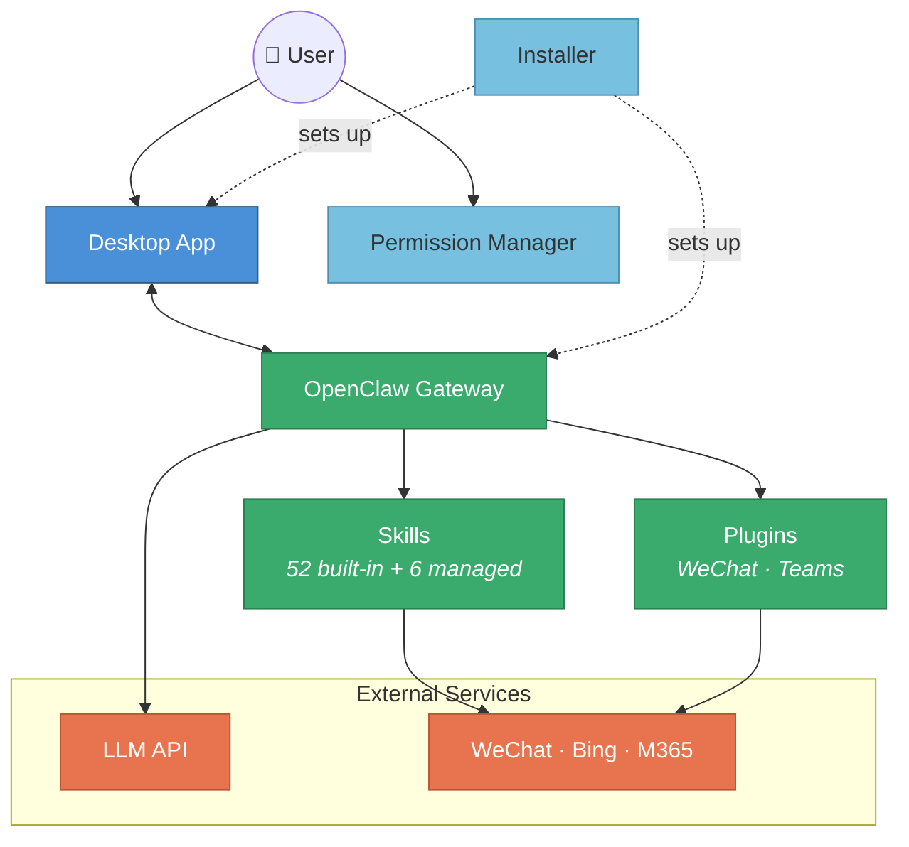

# 🦞 MicroClaw

[中文版](README.zh-CN.md)

**MicroClaw** makes [OpenClaw](https://github.com/openclaw) instantly available on Windows through a familiar, low-friction install experience. It packages the desktop client, local Gateway, managed runtime, preloaded skills, and permission-controlled sandbox into one product so users can get to real tasks quickly. You bring the LLM connection; MicroClaw brings the Windows app, local runtime, and trust boundary.

> [!WARNING]
> **AI & Security Notice**
> MicroClaw is an experimental open-source project initiated by Microsoft that provides a secure execution environment and user interface for the open-source [OpenClaw](https://github.com/openclaw) software that users have installed on their devices. MicroClaw is **not** an AI service, it doesn't contain an AI model, nor does it generate or alter user prompts, responses, or any AI-generated contents on behalf of users.
>
> All AI tasks including inferencing and content generation are solely performed by OpenClaw software with the AI model of your choice, accessed via your own API key and credentials. AI-generated content may be incorrect, AI is not a human, and it has no personality. The sandbox restricts what OpenClaw can access but does not prevent OpenClaw or the LLM from performing actions within the permissions you have granted. You are responsible for reviewing all prompts before submission and for not running prompts from untrusted sources.
>
> 📄 See [DISCLAIMER.md](DISCLAIMER.md) for the full disclaimer, including prompt injection risks, sandbox scope, and limitation of liability.

## Why MicroClaw

MicroClaw is designed to remove the usual Windows setup friction around OpenClaw. Instead of asking users to assemble Node.js, OpenClaw, local configuration, skills, and sandboxing by hand, it installs and wires those pieces together in a single flow.

### Instant Availability

- **Familiar Windows install flow**: packaged installer with desktop shortcut, Start menu entry, and one-click uninstall
- **One run sets up the runtime**: Git, managed Node.js, OpenClaw Gateway, the MicroClaw desktop app, managed skills, and AppContainer provisioning
- **Ready after install**: launch the app immediately after setup instead of building a local OpenClaw environment by hand

### Ready-to-Use Experience

- **Only the LLM is bring-your-own**: the user supplies the model endpoint, API key, and model name; the rest of the stack is installed and configured by MicroClaw
- **Fast path on first launch**: if no provider is configured, the app opens a setup wizard that asks only for model credentials; if `MODEL_*` values already exist in `.env`, MicroClaw can auto-configure them
- **Recommended tasks on day one**: the home screen ships with starter task cards and prompt suggestions so users can begin with concrete tasks instead of a blank chat box
- **Preloaded capability surface**: 52 bundled skills plus 6 managed skills are available as part of the default Windows experience; specialist agents add their own skills on demand

### Built-In Trust

- **Transparent, permission-controlled actions**: file and tool access requests are surfaced to the user instead of being silently granted
- **Sandboxed with Windows AppContainer**: tool execution runs inside an OS-enforced AppContainer boundary on supported systems
- **Hooks plus sandbox, defense in depth**: hook-based prechecks improve UX while AppContainer ACL enforcement remains the actual security boundary
- **Hard blocks for sensitive paths**: credential-heavy locations such as `.ssh` and cloud config folders are denied rather than merely warned about

---

## Architecture



### Key Interactions

| Path | Protocol | Description |
|---|---|---|
| Renderer ↔ Main Process | Electron IPC | `namespace:action` pattern (e.g. `chat:send-message`, `gateway:restart`) |
| Main Process ↔ Gateway | WebSocket JSON-RPC | Port 18789 loopback, Ed25519 device auth, streaming chat events |
| Main Process → Gateway | HTTP | `/health` polled every 10s; process spawn with auto-restart |
| Gateway → LLM | HTTPS | Streaming API calls to Claude / OpenAI / Gemini |
| Gateway → Skills | In-process | Agent loop invokes tool calls; results fed back to LLM |
| WeChat Plugin → WeChat | HTTPS | Long-poll `getUpdates` + `sendMessage` |
| Permission Manager → AppContainer | Win32 API | AppContainer security capabilities + Job Object resource limits |

---

## Components

| Component | Path | Stack | Description |
|---|---|---|---|
| **Desktop App** | `desktop/` | Electron 33 + TypeScript + Vue 3 + Element Plus | Chat UI, Gateway lifecycle management, system tray |
| **AppContainer Sandbox** | `appcontainer/` | .NET 9 + Node.js preload hooks | Windows AppContainer launcher + permission hooks for tool isolation |
| **Installer** | `deploy.py` + `deployer/` | Python 3 + Tkinter | Wizard-style graphical installer (can be packaged as a single exe) |
| **Skill Packs** | `skills/` | Markdown + JSON + Python/Node | Office, search, browser automation managed skills |
| **WeChat Plugin** | `plugins/openclaw-weixin/` | TypeScript + OpenClaw Plugin SDK | WeChat channel integration |

---

## Quick Start

MicroClaw targets **Windows 10/11**. For most users, the only thing you need to bring is an LLM endpoint and API key.

### 1. Install

> **Note on releases:** The MicroClaw GitHub release page does not ship a pre-built installer binary. Users build the installer from source themselves using the steps below. This is intentional — see the [Releases](#releases) section.

Build the installer from source, then run it:

> **Build prerequisites** (only needed to run `build.ps1`): **Node.js 26.1+ (recommended)** or **24.16+ on the 24.x line**, and **Python 3.10+**. OpenClaw **2026.10.2** requires `>=24.16.0 <25 || >=26.1.0`; Node 22 and 25 are unsupported. Install the Python build dependencies with `pip install -r requirements.txt` (this includes PyInstaller, used to package the installer exe). End users running the packaged `MicroClawInstaller.exe` do **not** need Python.

```powershell
.\build.ps1                                        # produces dist/MicroClawInstaller/MicroClawInstaller.exe
.\dist\MicroClawInstaller\MicroClawInstaller.exe   # run the installer wizard
```

The installer handles the Windows-side setup in a single run:

- Git for Windows (PortableGit → `~/.openclaw-git`)
- Node.js 26 via the official signed `.msi` (per-machine install to `%ProgramFiles%\nodejs\`, UAC-elevated; an existing supported system Node at that path is reused as-is; supported range: `>=24.16.0 <25 || >=26.1.0`, download fallback: `26.1.0`)
- OpenClaw Gateway, pinned to **2026.10.2** on the default `stable` channel (`npm install -g openclaw@2026.10.2`)
- Configures the npm registry mirror and V8 compile cache
- Installs the MicroClaw desktop client, managed skills, and Windows sandbox components; the WeChat plugin is not bundled or automatically installed
- Adds Windows Defender exclusions, creates desktop shortcuts (including one-click Uninstall)

After install, launch **MicroClaw** from the Start menu or the desktop shortcut. The desktop app auto-starts the Gateway.

To upgrade an existing installation, rerun the MicroClaw installer. It preserves the transactional backup, validation, and rollback flow; the legacy dependency helper refuses in-place OpenClaw upgrades. Old Node 22/23/25 configurations are advanced to a supported line. Upgrade rollback keeps the updated, pre-existing Node directory instead of deleting it and any restored OpenClaw package it contains. `stable` is an exact version pin, not npm's moving `latest` tag.

### 2. Add your model credentials

On first launch, the desktop app opens a SetupWizard only when model configuration is missing. The required user input is your model connection:

- Base URL
- API Key
- Model name

You can add or edit models any time under **Settings → Models**. Credentials are stored locally by the desktop app. If `.env` already contains `MODEL_BASE_URL`, `MODEL_API_KEY`, and `MODEL_NAME`, MicroClaw can prefill or auto-apply that configuration.

#### Local models (experimental)

**Settings → Models** lists cloud providers and **Local model** (llama.cpp) in compact cards. Existing saved custom API connections remain manageable, but the overview has no generic add-compatible-API button or unconfigured placeholder card. **Manage** expands the connection editor inline. Saving a connection there does not change the default model or send an AI test prompt; initial onboarding retains its existing flow. The default model is selected separately.

The Qwen and MiniMax cards show **Get API Key** without opening an editor. The links go directly to the [Bailian Beijing API-key console](https://bailian.console.aliyun.com/cn-beijing/model/settings/api-key) and [MiniMax API-key console](https://platform.minimax.cn/user-center/basic-information/interface-key), rather than a generic landing page. The inline editors retain the same links. Opening a website preserves the selected model and form input; browser-launch failures are surfaced.

The model button beside the chat composer searches configured models and the two managed local presets, **Qwen3.5 4B Q4_K_M** and **Qwen3.5 9B Q4_K_M**. Selection changes **only the current conversation**, using OpenClaw session overrides. New conversations carry their selected agent's explicit session key, including the main agent, so a model can be selected before the first message in multi-agent configurations. **Use agent default** clears that override without changing agent/global defaults, fallbacks, or other conversations. First use shows the exact model download size, missing embeddings, runtime disk reserve and CPU/GPU mode. Downloads require confirmation; selection changes only after successful preparation. Cancel/failure keeps the previous selection. Already-prepared models switch directly with an inline **Switching...** indicator, without briefly opening a preparation dialog or running setup/inference tests again. Preparation, failures and interrupted-operation recovery still use a persistent dialog.

Both the chat model picker and **Settings → Models → Default model** use the same collapsible provider groups. Only the currently selected model's provider opens by default; headings can be toggled with a click, Enter or Space. Search reveals matching groups, and clearing it restores the previous folds. Folding only changes the list display, never model configuration or downloads. The settings picker still changes the global default, while the chat picker changes only its conversation.

The chat picker shows **Loading models...** on its button for the first catalogue read, then opens the complete list. Later openings retain the previous list and file statuses while refreshing, replacing them together instead of repeatedly shrinking and repositioning the panel. Closing or leaving the button while the first read is pending prevents a late popup.

Changing an existing cloud **default model** uses a revision-guarded `config.patch` and waits for the Gateway's applied revision, rather than restarting the entire Gateway. Only the primary default changes; fallbacks, model policy, credentials, agent overrides and session overrides are retained. Copilot selection/catalogue reads use prepared model metadata, not full provider discovery. A rejected, uncertain or still-applying change reports an error without an automatic retry or rollback; an explicit upstream restart requirement is not reported as a successful hot switch.

If a conversation-model change becomes uncertain, the chat picker and model settings expose recovery rather than leaving all conversations locked. A fresh read can reconcile a completed RPC or a request whose original managed Gateway process has demonstrably stopped. Otherwise **Restart Gateway and recover** requires explicit confirmation, verifies shutdown of the owned process, and accepts the saved state without resending the patch or deleting history. A WebSocket reconnect or a matching model value alone is not proof that a delayed write has finished. Ordinary model switches still do not restart the Gateway.

The installer prepares the pinned official llama.cpp provider without downloading model weights or the inference runtime. The installer discloses the provider and its declared capabilities; explicit user-disabled plugin policies are preserved. The local card shows **Connected** when the provider is installed and enabled, independently of whether either model is downloaded. This is provider availability, not an inference health check. Older installations can explicitly review and enable the component in local settings.

When the pinned OpenClaw version is unchanged, a desktop update refreshes managed files without rerunning database migrations outside its lightweight rollback snapshot. Runtime upgrades still run the full migration flow; both paths require the installed desktop and Gateway to become ready before committing.

- Opening model settings reads saved configuration, small router presets and metadata of the two pinned cache files. Plugin status reads never call ClawHub search, full hardware discovery, inference or downloads. Online component lookup occurs only during an explicit component review/install action.
- Model rows show downloaded/not-downloaded or unknown file state. Missing files go through first-use preparation rather than becoming the active model. Cached weights can be reused after cancelled preparation; merely browsing never reads GGUF contents or scans the cache. Existing external connections remain separate.
- **Download and select** immediately replaces confirmation with progress and shows the Gateway's current download/runtime message. Repeated clicks cannot resubmit consent. Preparation errors stay visible; retrying reuses complete, hash-verified cached weights rather than downloading them again.
- **Model selection does not run “Test AI connection” or a tool-use probe.** **Start using** submits a revision-guarded `config.patch` and confirms the saved configuration has been applied using read-only revision checks. It does not generate a test reply or read a temporary file. Connection and model/tool compatibility errors are reported during actual chats. Configuration validation, conflicting-write protection and sandbox permissions remain unchanged; selection success does not certify model capabilities.
- **Managed models**: 4B is listed first as the lightweight choice; 9B has higher resource requirements and can be slow on CPU. Choosing 4B always prepares 4B, never an automatic 9B replacement. OpenClaw still owns hardware admission, download hashes, runtime installation and cancellation. A version/source-hash-pinned in-memory adapter adds exact selection to the 2026.9.3 provider's wizard, preserves existing model routes, and fails closed if its source or exact-model receipts change. The underlying OpenClaw installation is not modified.
- **Existing server**: expand **Advanced options and information** to connect to a llama-server you already run on `localhost`, `127.0.0.1`, or `::1`. Supply a key only if that service requires it. MicroClaw does not own or stop this server.
- Cloud and local connections are retained when changing models. Selection does not add automatic cloud fallbacks; any previously authored OpenClaw fallback or agent/session override still needs to be reviewed separately. Local inference does not make network-dependent skills offline.
- Cloud setup remains accessible while a local wizard is unfinished. Only saving or switching a model asks to cancel conflicting local setup first; declining leaves it untouched. The only unconfigured catalog entries offered are the two pinned local presets; existing saved connections are retained. Local connection management stays under advanced local settings.
- The integration checks the Gateway's advertised setup methods and supports OpenClaw 2026.10.2 or 2026.9.3+ within 2026.9.x. If the provider is missing from its built-in official catalog, MicroClaw verifies the official ClawHub package identity and requests `@openclaw/llama-cpp-provider@2026.9.3`, not a floating latest release. Downloads, runtime prerequisites and GPU support remain subject to the official provider.
- Actual configuration writes remain protected in Windows Node + MXC mode, while a response is active, or until conflicting setup has safely ended. Preparing a local model does not itself block existing chats; applying a model change still does. After a disconnection, resume the retained operation rather than starting it again. Cancellation can be refused while OpenClaw finishes a protected step.

**Windows compatibility:** MicroClaw includes the [upstream Windows file-open timestamp fix](https://github.com/openclaw/fs-safe/commit/6ae2e2e5086f2c48b813f78cb65fd787c9879a3f) for the exact `fs-safe@0.8.5` dependency bundled with the supported OpenClaw runtime. MicroClaw additionally handles deferred `ctime` changes after copying: only regular, single-link files with unchanged identity, size and modification time can be reconsidered, and their contents must match the SHA-256 captured during copying. Verification uses bounded buffers, rechecks the open handle and path, and checks the exact fingerprint again after mutation authorization before deletion. Genuine changes remain errors; hardlink aliases do not use this exception. A version- and SHA-256-pinned preload validates both move and cleanup modules and applies the changes in memory; installed OpenClaw files are not modified. Other dependency versions are left unchanged, and modified 0.8.5 source is rejected rather than patched speculatively. These checks run during file moves, not when opening model settings.

The pinned llama.cpp adapter also retries transient Windows runtime-directory publication failures (`EPERM`, `EACCES`, `EBUSY`) up to five times over 3.1 seconds. Each attempt checks the original directory identities and requires the destination to remain absent. Permanent errors remain visible; archive hashes, pre/post-install version checks, cancellation and sandbox enforcement are unchanged.

Exact-model selection also applies when OpenClaw 10.2 loads an immutable provider copy under the state's `tmp/plugin-captures` directory. The adapter requires the original and captured provider identities and source bytes to match the pinned artifact, rejects redirected paths, and never modifies installed plugin files. Model identity and download-consent checks remain mandatory.

Official plugin installation and the real Electron setup flow have been verified through model download consent on Windows, and complete preparation has been checked with private copies of cached 4B/embedding weights and a freshly installed runtime. This does not run inference or certify its speed. GGUF weights are never downloaded automatically. The existing **Other models** OpenAI-compatible endpoint configuration also remains available for a separately managed local server.

Local CPU replies can take longer, especially with the initial agent context. While the Gateway remains connected, the chat UI allows a bounded longer wait and checks history for a completed reply. Inactivity alone is shown as a waiting notice, not a model connection failure; a successful reply clears that inferred notice without hiding actual provider errors.

For developers, run the opt-in contract check against an installed OpenClaw entry:

```powershell
$env:MICROCLAW_TEST_OPENCLAW_ENTRY = 'C:\path\to\openclaw\openclaw.mjs'
npm --prefix desktop test -- src/local-model-gateway.integration.test.ts
```

Setting `MICROCLAW_TEST_INSTALL_LOCAL_PROVIDER=1` additionally installs the official plugin and checks separate exact-4B and exact-9B download consent steps in a disposable state directory. It checks cancellation without accepting the model download or modifying the user's OpenClaw configuration. Set `MICROCLAW_OPENCLAW_TEST_PACKAGE_DIR` to the OpenClaw package directory when running `src/openclaw-fs-safe-compat.test.ts` to verify both real pinned modules and confirm their installed bytes remain unchanged. Also set `MICROCLAW_TEST_LOCAL_PLUGIN_DIR` to an existing official plugin directory to exercise 100 offline copy/cleanup cycles and preservation of a concurrently changed source. `src/openclaw-fs-safe-cleanup.test.ts` covers timestamp, content, path and authorization races without an installed runtime.

Alternatively, set `MICROCLAW_TEST_LOCAL_PLUGIN_DIR` to an existing official llama.cpp plugin directory to exercise direct selection against a disposable Gateway and a local endpoint that rejects all inference requests. The check requires a successful configuration switch with zero inference requests and does not touch the user's selected model.

Run `npm --prefix desktop test -- src/local-model-preparation.integration.test.ts` with `MICROCLAW_TEST_OPENCLAW_ENTRY` and `MICROCLAW_TEST_LOCAL_PLUGIN_DIR` to verify exact-model download consent through the real provider loader, then cancel without downloading or changing defaults. To exercise complete preparation, additionally set `MICROCLAW_TEST_LOCAL_CACHE` to a cache containing the pinned 4B and embedding files. It copies those files into a disposable state directory, requires zero model/embedding download bytes in the consent receipt, and installs/verifies the official runtime. The runtime archive may be downloaded; model weights are not. The check does not select the model, run inference or change the source cache/user configuration.

### 3. Start working immediately

The default home screen is not empty. It ships with starter task cards such as daily news, desktop organization, and travel help, plus prompt suggestions for common work. The bundled and managed skills are already installed, so optional service-specific credentials can be added later only when a particular workflow needs them.

---

## Uninstall

**One-click uninstall** — double-click the **Uninstall MicroClaw** shortcut on your desktop (or run `MicroClawInstaller.exe --uninstall`). This removes the desktop app, skills, sandbox config, shortcuts, and the Node.js / Git / OpenClaw dependencies that the installer set up.

---

## Desktop App

The Electron desktop app is the primary user interface:

- **Chat Interface**: Built with Vue 3 + Element Plus, supports multiple sessions
- **Gateway Management**: Automatically starts/restarts the local OpenClaw Gateway
- **WebSocket Communication**: JSON RPC protocol with Ed25519 device authentication
- **Skill Integrity Detection**: SHA-256 checksums on all skill files at startup, Ed25519 signature verification
- **System Tray**: Runs in the background with status indicators

Development mode:

```bash
cd desktop
npm install
npm run dev
```

### Linting

ESLint is configured for both the main process and renderer. **Run lint before committing** to avoid CI failures:

```bash
# Desktop main process
cd desktop
npm run lint

# Renderer (Vue 3)
cd desktop/renderer
npm run lint
```

To generate SARIF output for CI integration:

```bash
npm run lint:sarif    # outputs eslint-results.sarif
```

---

## Sandbox Isolation

`appcontainer/` provides a Windows AppContainer-based sandbox for isolating tool execution:

- **.NET launcher** (`AppContainerLauncher.exe`) runs child processes inside an AppContainer with restricted ACLs
- **Node.js preload hooks** (`sandbox-preload.js`, `sandbox-fs-hooks.js`, …) intercept `fs.*` / `child_process.*` calls and prompt the user for permission
- **Sensitive-path shield** hard-denies access to `~/.ssh`, `~/.azure`, and other credential directories — no override

See [appcontainer/README.md](appcontainer/README.md) for details.

---

## Skill System

### Built-in Skills (52)

Installed alongside OpenClaw and controlled via the `skills.allowBundled` allowlist. Categories include:

| Category | Example Skills |
|---|---|
| Productivity | obsidian, notion, trello, slack, discord, things-mac |
| AI / Coding | coding-agent, gh-issues, oracle, skill-creator |
| Communication | bluebubbles, wacli, voice-call |
| Smart Home | openhue, blucli, sonoscli, eightctl |
| Media | spotify-player, songsee, video-frames |
| Utilities | weather, healthcheck, session-logs |
| Voice | openai-whisper, sherpa-onnx-tts, sag |

### Managed Skills (6)

Installed to `~/.openclaw/skills/`, these are custom advanced skills included in this project:

| Skill | Description |
|---|---|
| excel-xlsx | Create and edit Excel workbooks |
| powerpoint-pptx | Create and edit PowerPoint presentations |
| word-docx | Create and edit Word documents |
| officecli | Office document CLI tool (create/edit .docx/.xlsx/.pptx) |
| desktop-organizer | Scan and organize files on the Windows desktop |
| security-practice | AI agent safety practices (red/yellow line rules, install audit protocol) |

### Agent-Owned Skills

Agent-owned skills are dormant resources in the desktop package and are installed only
when their owning specialist agent is added:

| Agent | Skill | Description |
|---|---|---|
| Creative Muse | rednote-publisher | Create staged topic ideas, sourced material kits, and publish-ready Rednote packages |

---

## WeChat Plugin

`plugins/openclaw-weixin/` — Connects OpenClaw to WeChat:

- QR code login, no username/password needed
- Multi-account + sender isolation
- Supports text, image, video, and file messages
- Long-polling message updates

---

## Security Features

| Mechanism | Description |
|---|---|
| **Skill Integrity Checks** | SHA-256 hashes + Ed25519 signatures — detects tampering of all skill files at startup |
| **Device Authentication** | Each device generates an Ed25519 key pair; Gateway connections are signature-authenticated |
| **Skill Allowlist** | `allowBundled` / `allowManaged` control the available skill scope |
| **Sandbox Isolation** | OS-native AppContainer + Job Object isolation for file system, network, and resource limits |
| **Local Gateway** | Binds to loopback only — does not accept remote connections |

---

## Build

Full build pipeline (PowerShell):

```powershell
.\build.ps1
```

This script sequentially:

1. Builds the desktop app (`desktop/` → Electron Builder)
2. Creates portable zip package (`dist/microclaw-portable.zip`)
3. Packages the installer exe (PyInstaller → `dist/MicroClawInstaller.exe`)

### MSIX package

The CI and release workflows also build `desktop/release/MicroClawDesktop-<version>-x64.msix`
with Electron Builder. The package includes the Electron app, the pinned OpenClaw
runtime, Node.js, and the AppContainer launcher resources. On first launch, the
read-only bundled runtime archive is expanded under Electron's per-user
`userData` directory; configuration and other writable state remain in per-user
application data.

Build and validate it locally on Windows:

```powershell
npm ci --prefix desktop
npm run dist:msix --prefix desktop
$msix = Get-ChildItem .\desktop\release\MicroClawDesktop-*-x64.msix | Select-Object -First 1
.\scripts\windows\validate-msix.ps1 -Path $msix.FullName
```

Without configuration, the build uses a non-production `MicroClaw.Test` identity
for CI validation. Before Partner Center submission, configure
`MSIX_IDENTITY_NAME`, `MSIX_PUBLISHER`, `MSIX_PUBLISHER_DISPLAY_NAME`, and
`MSIX_APPLICATION_ID` from the reserved app identity. The publisher must exactly
match Partner Center (and the subject of any sideloading certificate). Store
submissions may remain unsigned because Microsoft signs accepted packages;
sideloaded packages must be signed with a trusted certificate after packaging.
The Partner Center identity values should be stored as GitHub Actions secrets,
not committed. Tagged workflows derive the MSIX version from the `vX.Y.Z` tag
and only attach the MSIX to the GitHub Release when all four production identity
secrets are configured; validation-identity packages remain Actions artifacts.
Store/MSIX installs use package-managed updates rather than the EXE
download-update path.

### Prerequisites

- Node.js 26.1+ (recommended), or 24.16+ on the 24.x line
- Python 3.10+ — install build deps with `pip install -r requirements.txt` (includes PyInstaller)
- .NET 9 SDK (for the AppContainer launcher)
- .NET 10 SDK (for the bundled Windows Node host)
- npm dependencies installed (`cd desktop && npm install`)

---

## Project Structure

Operational Windows scripts now live under `scripts/windows/`. Root `.bat` and `.ps1` files are retained as compatibility wrappers so existing commands keep working.

```
├── deploy.py                    # Stable installer entry point (Tkinter GUI)
├── deployer/
│   ├── config.py                # Configuration management (.env + YAML)
│   ├── logger.py                # Thread-safe logger + in-memory ring buffer
│   ├── skill_catalog.py         # 52 built-in + 6 managed skill catalog
│   ├── skill_manager_ui.py      # Skill selector dialog
│   └── windows_setup.py         # Windows install logic (Node/npm/OpenClaw)
├── desktop/                     # Electron desktop app
│   ├── src/                     # Main process (TypeScript)
│   └── renderer/                # Vue 3 renderer process
├── appcontainer/                # Windows AppContainer sandbox (.NET + preload hooks)
├── skills/                      # Managed skill definitions
├── plugins/openclaw-weixin/     # WeChat channel plugin
├── scripts/
│   ├── windows/                 # Canonical Windows helper scripts
│   └── generate-skill-snapshot.js
├── docs/
│   ├── architecture/            # Repo structure and architectural decisions
│   ├── plans/                   # Planning docs
│   └── reference/               # Design and setup reference material
├── build.ps1                    # One-click build script
├── launch.bat                   # Compatibility wrapper -> scripts/windows/launch.bat
├── setup.bat                    # Compatibility wrapper -> scripts/windows/setup.bat
├── setup-dependencies.ps1       # Compatibility wrapper -> scripts/windows/setup-dependencies.ps1
├── uninstall.bat                # Compatibility wrapper -> scripts/windows/uninstall.bat
├── uninstall-dependencies.ps1   # Compatibility wrapper -> scripts/windows/uninstall-dependencies.ps1
├── start-gateway.cmd            # Manual Gateway start
├── MicroClawDeployer.spec       # PyInstaller packaging config
└── requirements.txt             # Python dependencies
```

See [docs/architecture/repository-layout.md](docs/architecture/repository-layout.md) for the structural rules and the long-term migration target.

## Configuration

Most users can do everything from **Settings** inside the desktop app — models, Brave API key, skill allowlist, etc. Runtime settings live in `~/.openclaw/openclaw.json`; you can hand-edit it if needed.

Fresh installs include the official Parallel web-search plugin pinned to `2026.10.2` for
compatibility with the packaged OpenClaw target, and select its keyless
`parallel-free` provider, so web search works without additional setup. Usable existing web-search
provider choices are preserved during upgrades; Brave or Tavily without an API key falls back to
Parallel. The provider can be changed later in **Settings**.

For developers / unattended installs, the installer also accepts a `.env` file (`MODEL_BASE_URL`, `MODEL_API_KEY`, `MODEL_NAME`, `MODEL_API_FORMAT`, `MODEL_REASONING_EFFORT`, `BRAVE_API_KEY`) — see [.env.example](.env.example). `python deploy.py` reads `.env` from the repo root; the packaged `MicroClawInstaller.exe` reads `.env` from next to the exe.

## System Requirements

- Windows 10/11
- Python 3.10+ (only required to run the installer)
- Network connection (mainland China mirror support included)
- Optional: Microsoft Edge (browser skills)

## Releases

The MicroClaw GitHub release page is intentionally **source-only**: it does **not** publish prebuilt installer binaries (`MicroClawInstaller.exe`, portable zips, or any other packaged artifacts). Users obtain MicroClaw by cloning this repository and running `build.ps1` themselves. This keeps the distribution channel transparent and auditable — you only ever run binaries you produced from source you can inspect.

If you fork this project, please honor the same policy unless you intend to take on responsibility for code signing, malware scanning, and supply-chain attestation of any binaries you publish.

## Contributing

This project welcomes contributions and suggestions. Most contributions require you to agree to a
Contributor License Agreement (CLA) declaring that you have the right to, and actually do, grant us
the rights to use your contribution. For details, visit https://cla.opensource.microsoft.com.

When you submit a pull request, a CLA bot will automatically determine whether you need to provide
a CLA and decorate the PR appropriately (e.g., status check, comment). Simply follow the
instructions provided by the bot. You will only need to do this once across all repos using our CLA.

This project has adopted the [Microsoft Open Source Code of Conduct](https://opensource.microsoft.com/codeofconduct/).
For more information see the [Code of Conduct FAQ](https://opensource.microsoft.com/codeofconduct/faq/) or
contact [opencode@microsoft.com](mailto:opencode@microsoft.com) with any additional questions or comments.

See [CONTRIBUTING.md](CONTRIBUTING.md) for detailed contribution guidelines.

## Security

Please see [SECURITY.md](SECURITY.md) for information on reporting security vulnerabilities.

## License

MIT — see [LICENSE](LICENSE) for the full license text.
